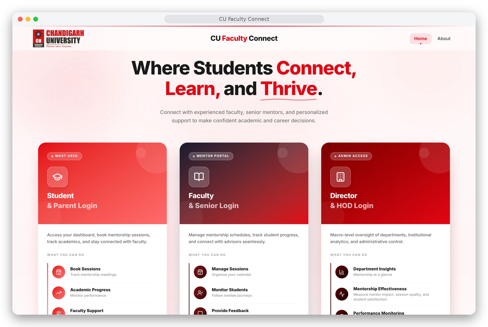
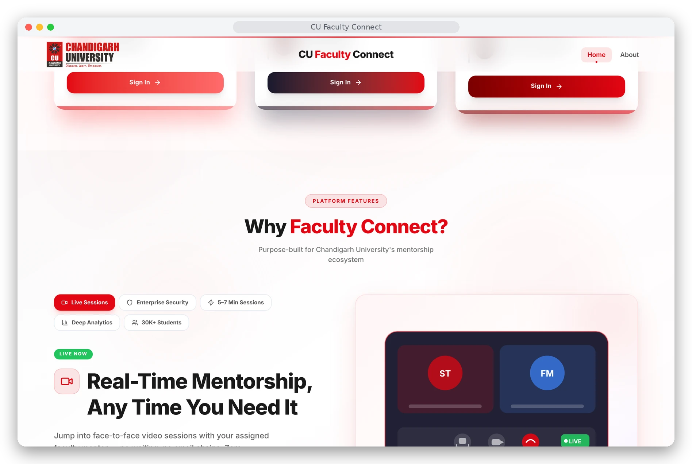
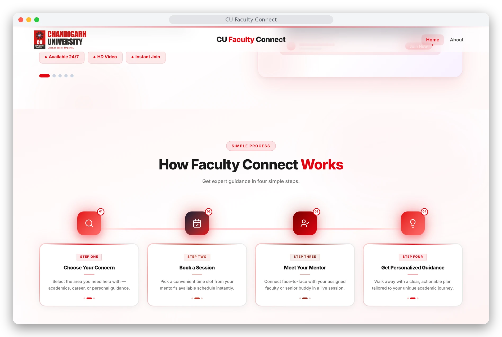
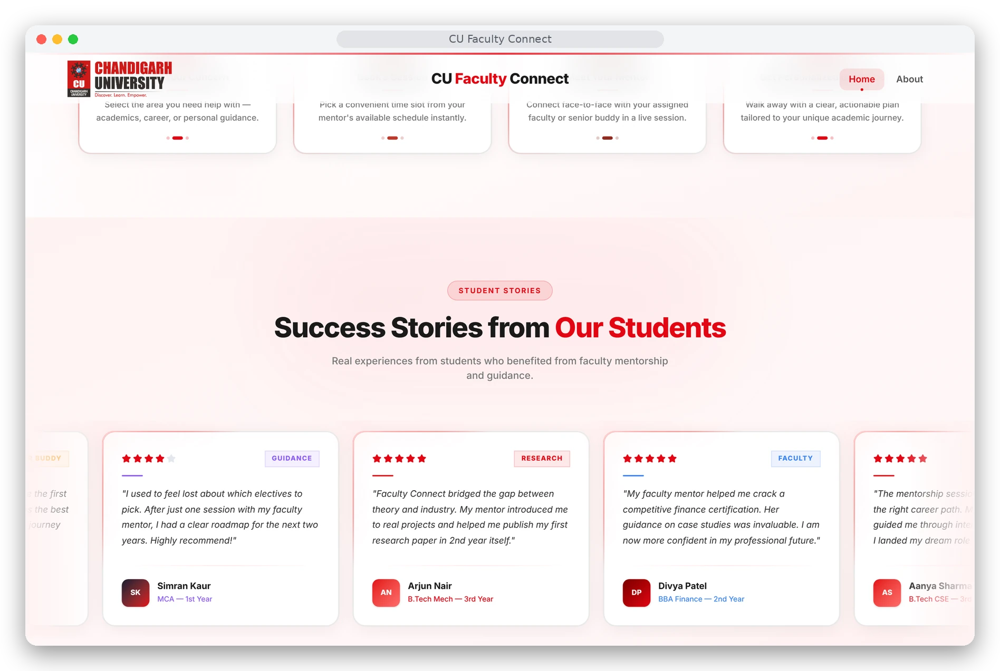
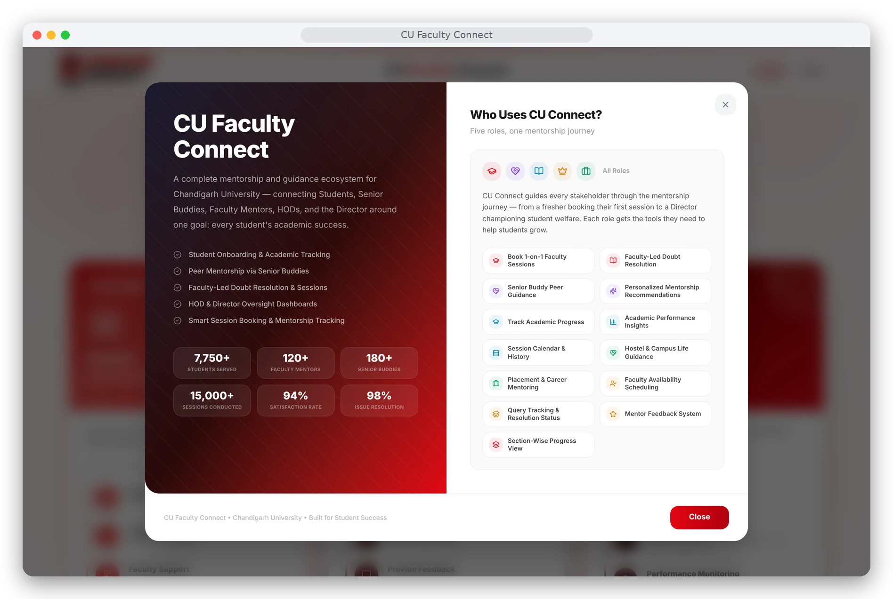

<div align="center">

# 🎓 CU Faculty Connect
### *A Trusted Digital Mentorship & Academic Support Portal for Chandigarh University*

[](https://cufacultyconnect.vercel.app)
[](https://react.dev/)
[](https://www.typescriptlang.org/)
[](https://vitejs.dev/)
[](https://tailwindcss.com/)
[](https://supabase.com/)

**Direct faculty interactions, peer-to-peer buddy mentoring, intelligent scheduling, and institutional oversight.**

[Explore Live Demo](https://cufacultyconnect.vercel.app) · [Screenshots](#-screenshots) · [Features](#-key-features-across-5-user-portals) · [Getting Started](#-getting-started-locally) · [Report Bug](https://github.com/kvalecha186-dot/cufacultyconnect/issues)

<br/>



</div>

---

## 📌 Overview

**CU Faculty Connect** is a full-fledged institutional mentorship and student guidance portal tailored specifically to the academic hierarchy and operational workflows of **Chandigarh University**. 

It eliminates the friction freshers and senior students face when seeking guidance, scheduling cabin or online interactions with faculty members, resolving doubts, and accessing academic support. The system seamlessly connects five core campus stakeholders into a unified digital ecosystem.

---

## 📸 Screenshots

<table>
  <tr>
    <td width="50%"><br/><sub><b>Platform features</b> — live sessions, security and analytics</sub></td>
    <td width="50%"><br/><sub><b>How it works</b> — four simple steps from concern to guidance</sub></td>
  </tr>
  <tr>
    <td width="50%"><br/><sub><b>Student stories</b> — feedback from the mentorship programme</sub></td>
    <td width="50%"><br/><sub><b>About dialog</b> — who uses CU Connect and what each role gets</sub></td>
  </tr>
</table>

> Screenshots are captured from the running application. Role dashboards sit behind sign-in and are not shown here.

---

## 🌟 Key Features Across 5 User Portals

### 1. 🎓 Student & Parent Portal
* **Academic Profile Strip**: Live representation of student metrics (Course: *B.E. CSE AI & ML*, Section: *25AML-304*, Block: *B1*, Semester: *1*, Batch: *2025*).
* **Smart Interaction Scheduler**: Book 1-on-1 sessions with designated mentors (Mon–Fri) in either **Online (Google Meet/Zoom)** or **Offline (Cabin/Block)** mode.
* **Senior Peer Buddy Program**: Freshers can directly submit doubts to mapped senior mentors (3rd/4th year students).
* **Live Session Lifecycle**: Dynamic countdown timers, meeting status badges (`Pending` ➔ `Assigned` ➔ `In-Progress` ➔ `Completed`), and direct one-click *"Join Meeting"* button when links are dispatched.
* **Session Preparation Kit**: Structured checklists and discussion notes before joining a meeting.
* **Post-Session Feedback**: 1–5 star ratings and written reviews after completed sessions.
* **Campus Ready Guides & Clubs**: Essential fresher survival checklists, hostel rules, and student club directories.

### 2. 👨‍🏫 Faculty Mentor Portal
* **Incoming Request Queue**: Real-time triage of pending queries with student academic context, UID, Section, and concern previews.
* **Start Meeting Dispatcher**: Easily paste or auto-generate meeting links (Google Meet, Zoom) or assign offline cabin venues (e.g. *Block B1, Cabin 312*).
* **Assigned Mentees Directory**: Monitor academic health, attendance warnings ($<75\%$), and doubt frequency for all students in mapped sections (`25AML-301`, `25AML-302`, `25AML-303`, `25BCS-201`).
* **Session Lifecycle Manager**: Accept, conduct, reschedule, or complete sessions with timestamped logs.

### 3. 🤝 Senior Peer Mentor Portal
* **Fresher Guidance Hub**: Senior students guide assigned junior sections (`25AML-101`, `25AML-102`).
* **Peer Discussion Forum**: Collaborative doubt-clearing and guidance channel.
* **Opportunity Broadcast**: Post hackathons, competitive programming contests, internships, and workshop announcements.
* **Gamified Rewards Ledger**: Points and badges earned based on queries solved and feedback ratings.

### 4. 👑 HOD Command Center
* **Department Oversight**: Department-wide monitoring (e.g., *Dept. of AI & ML, Blocks B1 & B2*).
* **Faculty Audit**: Compliance tracking (sessions completed vs. target, doubt resolution turnaround time, average student satisfaction rating).
* **Interactive Analytics**: Visual charts powered by **Recharts** detailing category-wise query distribution, monthly mentorship trends, and student engagement.

### 5. 🏛 University Director Oversight
* **Institutional Executive View**: Comprehensive university-wide metrics aggregated across all departments (*CSE AI/ML, Core CSE, Data Science, Cyber Security, IT, BCA, MBA, Pharmacy, ECE*).
* **Student Welfare & Risk Radar**: Automated alerts for at-risk students requiring early academic intervention.
* **Top Performers Recognition**: Leaderboards for top-rated faculty mentors and senior peer guides.
* **Integrated Audit Directories**: Searchable drill-downs for all institutional sessions and student records.

---

## 🛠 Tech Stack

| Domain | Technology / Library |
| :--- | :--- |
| **Framework** | [React 18](https://react.dev/) + [Vite 6](https://vitejs.dev/) |
| **Language** | [TypeScript](https://www.typescriptlang.org/) |
| **Styling** | [Tailwind CSS v4](https://tailwindcss.com/) + Custom Design Tokens |
| **UI Components** | [Radix UI](https://www.radix-ui.com/) / [shadcn/ui](https://ui.shadcn.com/) |
| **Animations** | [Framer Motion](https://www.framer.com/motion/) |
| **Data Visualization** | [Recharts](https://recharts.org/) |
| **Icons** | [Lucide React](https://lucide.dev/) |
| **Notifications & Effects** | `Sonner` (Toasts), `canvas-confetti` |
| **Routing** | [React Router 7](https://reactrouter.com/) with deep-linked role dashboards |
| **Backend & Auth** | [Supabase](https://supabase.com/) (PostgreSQL, Auth, Row Level Security) |
| **Deployment** | [Vercel](https://vercel.com/) |

---

## 📂 Project Structure

```text
cufacultyconnect/
├── public/
├── src/
│   ├── assets/              # Campus graphics, blocks, badges, CU logo
│   ├── styles/              # Tailwind CSS v4 & theme design tokens
│   └── app/
│       ├── App.tsx          # Root controller & view dispatcher
│       ├── components/
│       │   ├── CUIMSLanding.tsx         # University landing page
│       │   ├── LoginModal.tsx           # Multi-role authentication & dynamic CAPTCHA
│       │   ├── DashboardShell.tsx       # Universal responsive layout & role switcher
│       │   ├── BookInteractionModal.tsx # Booking scheduler modal
│       │   ├── AboutModal.tsx           # Institutional about dialog
│       │   ├── dashboards/
│       │   │   ├── StudentView.tsx               # Student portal & live interaction engine
│       │   │   ├── FacultyMentorView.tsx         # Faculty portal & meeting dispatch
│       │   │   ├── SeniorBuddyView.tsx           # Senior peer mentor portal
│       │   │   ├── HODCentralView.tsx            # HOD command center
│       │   │   ├── HODAnalyticsDashboard.tsx     # Department Recharts analytics
│       │   │   ├── DirectorView.tsx              # University director oversight
│       │   │   ├── MentorAnalyticsDashboard.tsx  # Institutional audit analytics
│       │   │   ├── StudentDirectoryDashboard.tsx # University student directory
│       │   │   └── SessionDirectoryDashboard.tsx # Historical sessions directory
│       │   └── ui/                      # 40+ Accessible Radix/shadcn UI primitives
│       └── data/
│           ├── cuAcademicData.ts        # CU academic hierarchy (Blocks A1-D7, Courses, Sections)
│           ├── mentorshipStore.tsx      # In-memory reactive context & session state machine
│           └── sessionStore.ts          # Live meeting link and completed sessions store
├── supabase/
│   ├── schema.sql           # Database schema
│   └── migrations/          # RLS hardening, restricted student directory, private RLS helpers
├── vercel.json              # Vercel SPA routing rewrites
├── vite.config.ts           # Vite + Tailwind build configuration
└── package.json
```

---

## ⚡ Getting Started Locally

### Prerequisites
* **Node.js** (v18.0.0 or higher recommended)
* **npm** or **pnpm**

### Installation

1. **Clone the repository:**
   ```bash
   git clone https://github.com/kvalecha186-dot/cufacultyconnect.git
   cd cufacultyconnect
   ```

2. **Install dependencies:**
   ```bash
   npm install
   ```

3. **Configure Supabase:** copy `.env.example` to `.env` and add your project values:
   ```env
   VITE_SUPABASE_URL=https://your-project-id.supabase.co
   VITE_SUPABASE_ANON_KEY=your-anon-public-key
   ```
   Apply `supabase/schema.sql` and the files in `supabase/migrations/` to your Supabase project.

4. **Start the local development server:**
   ```bash
   npm run dev
   ```
   Open [http://localhost:5173](http://localhost:5173) in your browser to view the application.

5. **Build for production:**
   ```bash
   npm run build
   ```

---

## 🚀 Roadmap

- [x] **Database Integration**: Supabase PostgreSQL with schema and migrations.
- [x] **Real Authentication**: Supabase Auth with role-scoped Row Level Security (RBAC).
- [ ] **WebSockets Engine**: Instant live push notifications when faculty shares meeting links.
- [x] **Deep Link Routing**: Full URL routing for `/student`, `/faculty`, `/senior`, `/hod`, `/director`.
- [ ] **Native Video Rooms**: WebRTC / Agora integration for direct in-browser 1-on-1 audio/video calls.

---

## 👤 Author

**Khushi Valecha**
* GitHub: [@kvalecha186-dot](https://github.com/kvalecha186-dot)
* University: Chandigarh University

---

<div align="center">
  <sub>Built with ❤️ for the students and faculty of Chandigarh University.</sub>
</div>
